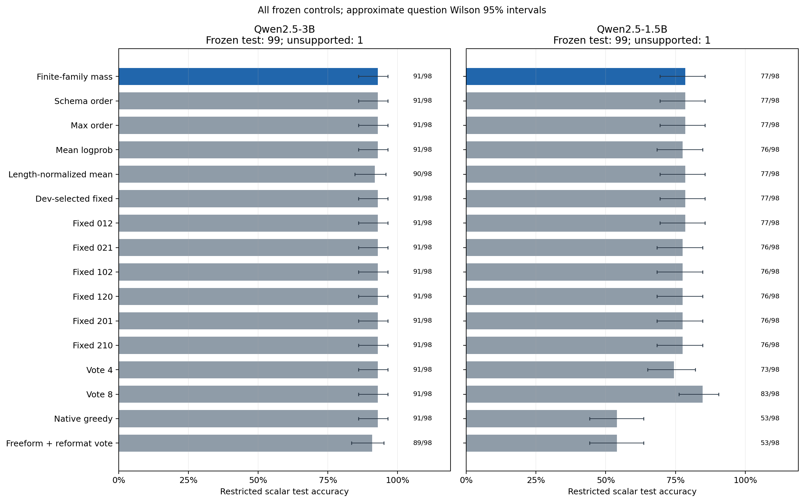
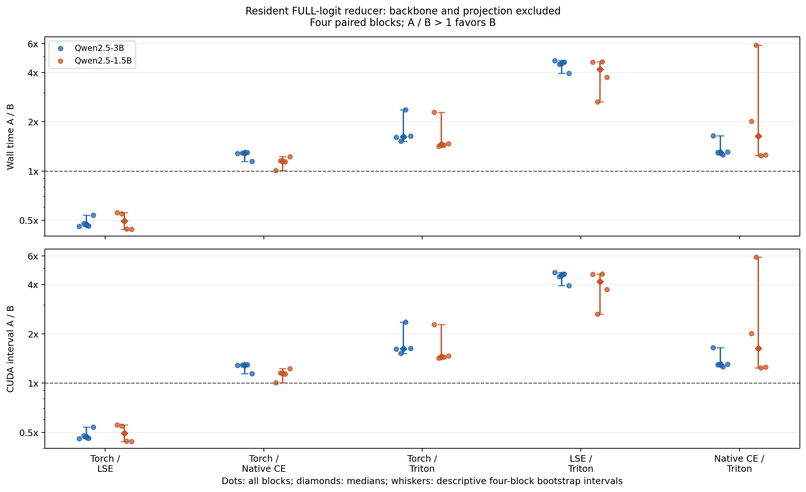

# OrbitCall

Tool-call likelihood scoring and GPU logprob normalization, evaluated on DGX Spark.

OrbitCall enumerates a small family of JSON spellings for each generated tool
call, scores every terminated token sequence, and sums their probabilities.
It also implements shared-prefix tree scoring and a requested-token logprob
reducer so that the statistical decision rule and its execution cost can be
studied separately.

**Completed study:** two pinned Qwen2.5 models, 119 frozen BFCL-derived inputs,
230 passing tests, answer-isolated predictions, whole-population numerical
audits, and paired ABBA measurements. The Triton reducer is faster than direct
native cross-entropy on the captured FP32 logits; complete scorer latency is
essentially unchanged. Finite-family mass does not outperform the strong
fixed-order controls on this held-out set.

[Results and all controls](evidence/RESULTS.md) ·
[Machine-readable results](evidence/summary.json) ·
[Reproduce](docs/REPRODUCE.md) · [Theory](docs/THEORY.md) ·
[Raw evidence archive](evidence/raw_results_v2.tar.gz)

## What is implemented

- **Finite key-order mass:** compact JSON with a fixed `name`/`arguments`
  envelope; all permutations of two or three required flat scalar arguments;
  unchanged argument values; one explicit tokenizer end token. Distinct token
  sequences are counted once.
- **Three teacher-forcing paths:** independent full-prompt batching, immutable
  prompt-cache batched suffix scoring, and a packed prefix tree whose attention
  mask includes only the prompt and each node's ancestors. All task-quality
  predictions use the full FP32 reference path; cache/tree paths are numerical
  diagnostics after their unchanged tolerance gates failed.
- **Full-vocabulary requested-token logprobs:** Torch log-softmax, centered
  logsumexp, and cross-entropy controls, plus an optional three-stage Triton
  reduction. Every vocabulary logit remains in the denominator. The Triton
  path avoids a full log-softmax output, not the model's vocabulary projection.
- **Answer-isolated ranking:** candidate generation and every score aggregator
  operate without gold answers. Predictions, raw item shards, and source/input
  hashes are frozen before the separate scalar AST/value evaluator reads gold.
- **An optional exact finite-table certificate:** rational lower/upper bounds
  can certify the winner for a complete supplied probability table. This module
  neither queries a model nor certifies raw floating-point GPU scores.

The Python source is in [src/orbitcall](src/orbitcall). The precise definitions,
floating-point limits, and certificate proof are in [THEORY.md](docs/THEORY.md).

## The decision rule

For a fixed prompt `p`, candidate call `a`, and its declared family `S(a)`:

~~~text
log M(a) = logsumexp({ sum_t log P_model(s_t | p, s_<t) : s in S(a) })
~~~

`M(a)` is the probability of this **finite serialization family**. It is not a
complete posterior over all ways to express the same program or intent.
Whitespace variants, other envelopes, other tokenizations, and other semantic
equivalences are outside the family. Missing/null, scalar types, and array
order remain distinct; duplicate keys are rejected.

A different representative key order reconstructs the same declared family.
Changing the input prompt does not have this invariance. When all candidates
have equal family size, mean probability and summed probability rank identically.
Higher probability mass does not guarantee a correct call.

The library-only example [finite_family_mass.py](examples/finite_family_mass.py)
shows the serialized family and can aggregate caller-supplied sequence scores.
It contains no model weights, benchmark measurements, or invented model scores.
Run its numerical use on Spark under the project protocol.

Model scoring defaults to `method="full"`. Select `cached` or `tree` explicitly
only for research diagnostics: the tree population-wide numeric gate failed for
one 3B input. After the completed artifact audits, the release changed only this
default dispatch parameter; all measured study arms already passed their method
explicitly. [Release validation](docs/RELEASE_VALIDATION.md) preserves the exact
one-line difference and the original experiment snapshots.

## Experimental scope

All tests, eligibility/split computation, inference, likelihood scoring, timing,
and statistical analysis for this study run on **DGX Spark (NVIDIA GB10)**.
Windows is used for editing, public asset transfer, publication, and document
rendering. There is no hosted model API or training stage.

| Stage | Declared configuration |
| --- | --- |
| Models | Public revision-pinned Qwen2.5-3B-Instruct and Qwen2.5-1.5B-Instruct |
| Candidate generation | BF16, SDPA, batch size 8; four primary samples plus separately reported controls |
| Task-quality scoring | Full-prompt FP32 reference with Torch LSE; eager attention and TF32 disabled |
| Cache/tree scope | Whole-population numerical diagnostics; no accepted cache/tree speed result |
| Systems comparison | Same full FP32 backbone with Torch log-softmax, LSE, native CE, or Triton normalization |
| Full-Triton audit | Stored full-reference token arrays, batch 8, head chunk 32; 3e-5-nat per-token gate over the frozen population |
| Inputs | Pinned BFCL v4 Python-simple and live-simple inputs; one function with two/three required flat scalar arguments |
| Split | 119 inputs: 20 development / 99 test; schema-grouped input-only freeze before answers |
| Evaluation | Restricted scalar AST/value agreement; not official full BFCL accuracy or a leaderboard submission |

The [frozen protocol](PROTOCOL.md) records the prospective amendments and
retained failures. BF16 generation and FP32 scoring are different stages.
The initial all-item FP32 cache/tree ranking gate and the original packed
development benchmark both failed the unchanged 1e-3-nat token threshold.
The latter failed before timing. These two FP32 failures, and earlier BF16
failures, remain evidence; they do not support an exact fast path or an RQ2
cache/tree speed claim. New reference-quality runs retain every item and
derive every aggregator's prediction from full FP32 scores.

The separate normalizer study changes only the requested-token normalization
backend on the same full backbone. Its first 3B attempt exhausted the
600-second ceiling after 78 of 80 validated scorer windows, before completing
the scorer schedule or the reducer stage. That incomplete run yields no
accepted speed ratio. An infrastructure retry uses fresh `budget_v2` run IDs
and a declared 1200-second ceiling, retaining the same fixtures, arms, ABBA
seed, all 80 scorer windows and the complete reducer schedule. No favorable
partial ratios are selected. All attempts contribute to cumulative cost.

The same-score controls are canonical schema order, development-selected fixed
order, maximum over orders, mean logprob, and mean length-normalized logprob.
Sampling controls are four-sample semantic voting, eight-sample voting, native
greedy, and freeform reasoning followed by reformatting. Their measured token
and wall-time budgets must be reported; extra sampling is not automatically
equal-cost.

## Results

The quality evaluator supports 98 of the 99 frozen test questions. The remaining
label is retained as unsupported, with unknown-outcome bounds in the JSON;
it is not silently treated as correct or removed from the frozen population.
Accuracy below is restricted scalar BFCL AST/value agreement, not the official
BFCL leaderboard. Only the development set selects a fixed-order comparator.

| Held-out method | Qwen2.5-3B | Qwen2.5-1.5B |
| --- | ---: | ---: |
| Finite-family mass | 91/98 (92.86%) | 77/98 (78.57%) |
| Canonical schema order | 91/98 (92.86%) | 77/98 (78.57%) |
| Development-selected fixed order | 91/98 (92.86%) | 77/98 (78.57%) |
| Vote 4 | 91/98 (92.86%) | 73/98 (74.49%) |
| Vote 8 | 91/98 (92.86%) | 83/98 (84.69%) |
| Native greedy | 91/98 (92.86%) | 53/98 (54.08%) |

Mass ties the strong same-score controls; no marginalization-specific quality
gain is established. Eight-sample voting uses twice the direct-sampling
allocation and is strongest on the 1.5B test set. All 16 controls, Wilson
intervals, paired question/schema uncertainty and generation budgets appear in
the [complete report](evidence/RESULTS.md).

### Normalizer performance

These are **A wall time / B wall time** medians across four paired ABBA blocks;
values above one favor B. Both captured resident fixtures are **32 × 151936,
FP32, contiguous**, with one requested token per row. The isolated reducer
excludes the backbone and vocabulary projection. The complete scorer includes
the same full backbone, parsing, tokenization, packing, transfers, extraction
and aggregation; it excludes generation and checkpoint loading.

| Stage and pair (A / B) | Qwen2.5-3B median [block range] | Qwen2.5-1.5B median [block range] |
| --- | ---: | ---: |
| Resident native CE / Triton | **1.3028×** [1.255, 1.646] | **1.6310×** [1.242, 5.861] |
| Resident log-softmax / Triton | 1.6206× [1.520, 2.363] | 1.4530× [1.419, 2.279] |
| Complete full native CE / full Triton | 1.0004× [0.9982, 1.002] | 1.0021× [1.002, 1.002] |
| Complete full log-softmax / full Triton | 0.9998× [0.9986, 1.001] | 1.0022× [0.9986, 1.003] |

The resident kernel benefit does not establish a practically meaningful
complete-scorer or serving-throughput benefit. The 1.5B native-CE pair has a
wide four-block range; its median is not a stable universal speedup. Direct
native CE and centered LSE are retained as strong controls. There are four
development fixtures for 3B and three for 1.5B, selected without answers.
Each completed model study retains all 80 scorer and 80 reducer windows.

[Complete scorer blocks](evidence/figures/scorer_block_ratios.png) show why the
kernel result should not be described as an end-to-end inference acceleration.

### Numerical validity and retained failures

| Full Triton vs frozen full-LSE reference | Qwen2.5-3B | Qwen2.5-1.5B |
| --- | ---: | ---: |
| Frozen population | 119 | 119 |
| Scored nonempty / zero-candidate items | 119 / 0 | 103 / 16 |
| Maximum token-logprob error | 9.54e-7 nats | 1.91e-6 nats |
| Winner agreement, each of all 11 aggregators | 119/119 | 103/103 |
| Fixed audit threshold | 3e-5 nats/token | 3e-5 nats/token |

The cached/tree path failed its unchanged 1e-3-nat gate on `simple_python_279`
for 3B; a full-FP32 amendment made all quality predictions independent of that
failed backend. The original packed benchmark failed before timing, so no
cache/tree speed ratio is accepted. Earlier BF16 failures and the incomplete
600-second normalizer attempt remain in the raw archive and cost accounting.
[NUMERICAL_VALIDITY.md](docs/NUMERICAL_VALIDITY.md) documents the disposition.

The cumulative measured component subtotal is **3161.201 seconds (0.8781
host-stage hours), a lower bound**, including retained failed runs. It is not
pure GPU-busy time or a complete budget measurement. Both public checkpoints,
all population items, zero-candidate failures, and all timing blocks are retained.

A real-arithmetic tree identity is not bitwise GPU equality. The full-Triton
audit is an empirical offline comparison, not an online certificate or a
universal numerical guarantee. Kernel latency is not complete scorer latency,
and scorer savings are not complete pipeline savings. The cost subtotal is a
lower bound on recorded host-stage wall time, not pure GPU-busy time or proof
of complete budget compliance. Table-certificate expansion counts are not
model forward passes saved. The release must retain these distinctions.

## Installation and reproduction

Python **3.12 or later** is required. Core parsing, family aggregation, and
finite-table certificate modules use the standard library. Model execution
requires the separately declared runtime/CUDA extras.
Statistical evaluation additionally requires the analysis extra.

~~~bash
# On the authorized Spark environment after checking its CUDA/PyTorch build:
python -m pip install --no-deps --no-build-isolation -e .
~~~

Do not replace a working GB10 PyTorch stack with an arbitrary package-index
wheel. The pinned study metadata records Python 3.12.3, PyTorch
2.13.0+cu130, Transformers 5.15.0, Triton 3.7.1, NumPy 2.3.5, and pytest 9.1.1.
The runtime/CUDA/test extras in [pyproject.toml](pyproject.toml) declare these versions;
`metadata/runtime.json` and each run's receipts identify the actual environment.
The completed analysis used SciPy 1.18.0 and Matplotlib 3.10.3; model asset
transfer used Hugging Face Hub 1.28.0. All 230 tests ran on Spark.

Follow [REPRODUCE.md](docs/REPRODUCE.md) for pinned downloads, checkpoint
verification, input freezing, correctness gates, candidate generation, ranking,
timing, and post-freeze evaluation. Do not fetch either answer file until
**both models' predictions are frozen**.

## Prior work and attribution

This project makes no first-invention claim for semantic marginalization,
format sensitivity, tree attention, prefix reuse, stable logsumexp, cross-entropy
reduction, or branch-and-bound certificates. Relevant prior work includes
semantic uncertainty/marginal likelihood, Medusa tree attention, TreeRanker
candidate scoring, structured-output studies, and optimized cross-entropy
kernels. [RELATED_WORK.md](docs/RELATED_WORK.md) links primary sources and
describes the narrower scope of this implementation.

## Licenses and publication contents

Original OrbitCall code and documentation are covered by the [MIT license](LICENSE).
Third-party models and benchmark materials retain their own licenses:

- [Qwen2.5-3B-Instruct at the pinned revision](https://huggingface.co/Qwen/Qwen2.5-3B-Instruct/blob/aa8e72537993ba99e69dfaafa59ed015b17504d1/LICENSE):
  **Qwen Research License Agreement**, with noncommercial-use terms.
- [Qwen2.5-1.5B-Instruct at the pinned revision](https://huggingface.co/Qwen/Qwen2.5-1.5B-Instruct/blob/989aa7980e4cf806f80c7fef2b1adb7bc71aa306/LICENSE):
  **Apache-2.0**.
- BFCL inputs: pinned Gorilla **Apache-2.0** provenance and retained license,
  documented in [RELATED_WORK.md](docs/RELATED_WORK.md).

Public availability does not give both checkpoints the same permissions, and
OrbitCall's MIT license does not relicense them. The public repository is
intended to contain original implementation, commands, provenance, and reviewed
evidence. It excludes model weights, answer files, credentials, private absolute
paths, and unrelated research artifacts. The [archive manifest](evidence/MANIFEST.json)
maps published bytes to source hashes; only console traceback paths are redacted.
Scientific score, prediction and timing JSON remains byte-preserved. The
presentation-only [figure render receipt](evidence/figures/RENDER_RECEIPT.json)
links the reviewed figures to the unchanged numerical summary; original analysis
figures remain retained alongside them.

