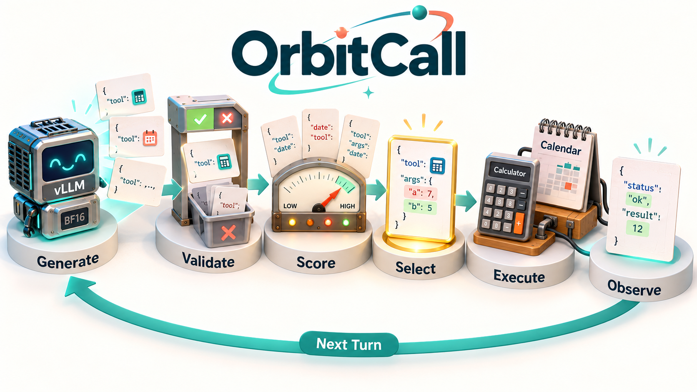
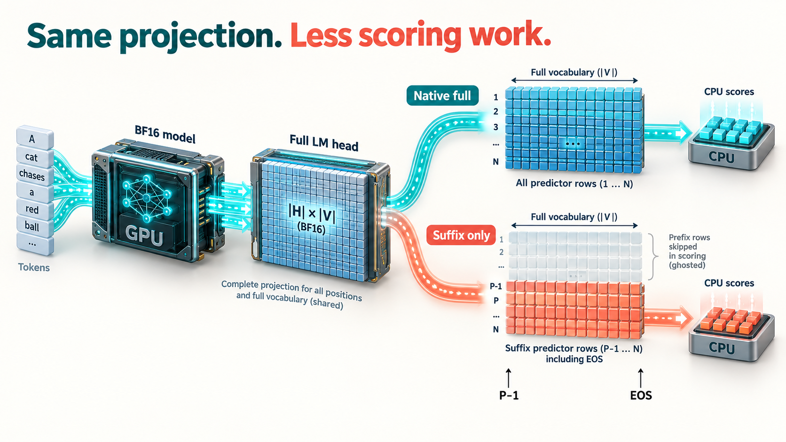
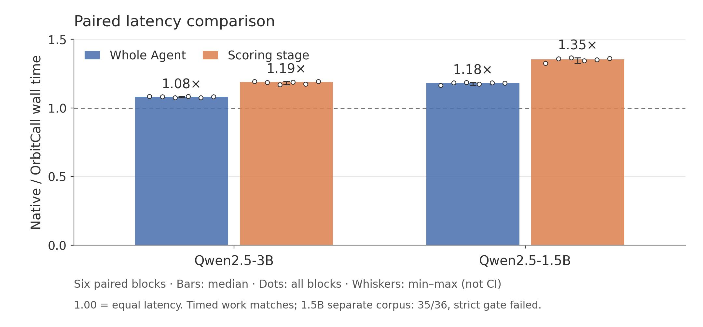
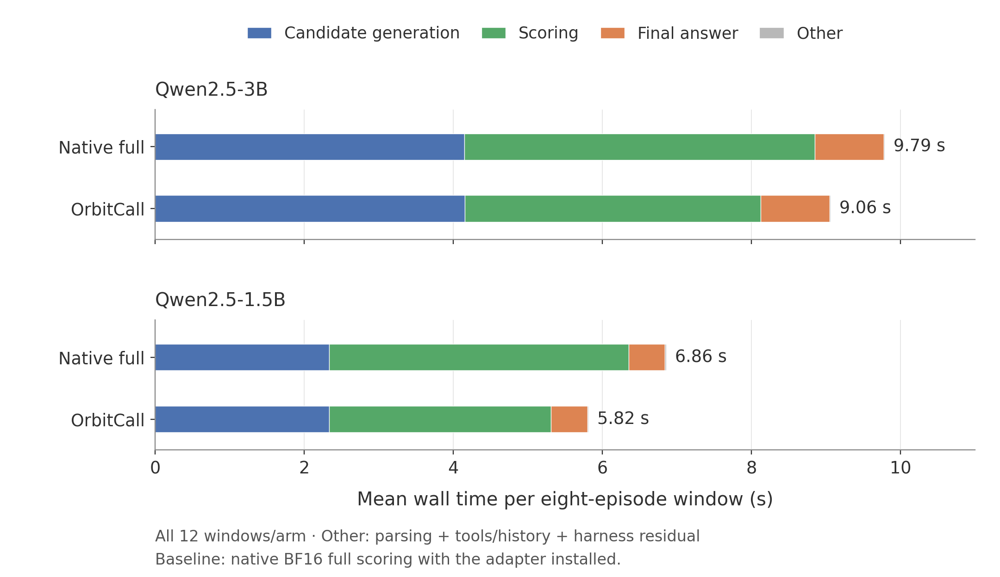

# OrbitCall

**Tool-call scoring for CUDA-based vLLM Agents.**

OrbitCall is an opt-in vLLM plugin for CUDA GPUs.
Generate candidates, score their finite JSON key-order families, execute a tool,
and use its actual observation in the next round. The plugin follows the
loaded model's native execution dtype; the demo defaults to `--dtype auto`.



*Two tool rounds use actual observations, followed by a generated final answer.*

## Trim the scoring overhead

The vLLM0.29 plugin preserves the **full native LM-head projection**.
It then normalizes, ranks and transfers only the required suffix rows,
retaining full-vocabulary probabilities and every JSON/EOS token.



*Same backbone and full LM-head projection; fewer rows for probability processing and transfer, retaining P−1 and the row predicting EOS.*

Conceptual illustrations generated with ChatGPT; cards and matrices are schematic.
[Illustration prompts](docs/ILLUSTRATION_PROMPTS.md)

## Benchmarks

The experiments below ran on NVIDIA DGX Spark (GB10).

| Qwen2.5 | Complete Agent ratio | Scoring-stage ratio | Native / optimized task success |
| --- | ---: | ---: | ---: |
| 3B | **1.08x** | 1.19x | 36/36 / 36/36 |
| 1.5B | **1.18x** † | 1.35x | 31/36 / 31/36 |

Six paired blocks/model; eight fixed workflows; actual generation, two tools
and final answers. Baseline: native BF16 full scoring with the adapter installed.
Both models' timed work matches. † One unselected 1.5B candidate differs in the
separate 36-task pass; its strict corpus-consistency gate remains failed.
Calls, observations and final answers match. These are local executable fixtures.





**144/144 locked round pools:** zero score error; all eleven decisions match.
**419 tests passed in the experimental environment.** [Report and controls](evidence/vllm_agent/RESULTS.md) ·
[Raw runs](evidence/vllm_agent/raw_results_v1.tar.gz) · [Frozen protocol](docs/VLLM_AGENT_SHAPE_PROTOCOL.md)

## Try it

With a compatible vLLM0.29/CUDA environment and a downloaded checkpoint:

```bash
python -m pip install --no-deps --no-build-isolation -e .
PYTHONPATH=src python examples/vllm_agent.py \
  --model models/Qwen2.5-1.5B-Instruct --output demo_agent.json
```

Use `--dtype float16` or `--dtype bfloat16` to override the model default.
The adapter preserves the dtype selected by vLLM without recasting model
weights or hidden states. FP16 and automatic selection passed the separate
development compatibility check. [Compatibility evidence](evidence/dtype_compatibility/RESULTS.md)

[Setup and reproduction](docs/VLLM_REPRODUCE.md) · [Theory](docs/THEORY.md) ·
[Prior work](docs/RELATED_WORK.md) · [Historical FP32 study](evidence/acceleration/RESULTS.md)

Original code/fixtures: MIT; vLLM-derived plugin: Apache-2.0
([credits](THIRD_PARTY_NOTICES.md)). Checkpoint licenses apply separately.
This is an external opt-in plugin; earlier failed APC variants remain in the evidence.
