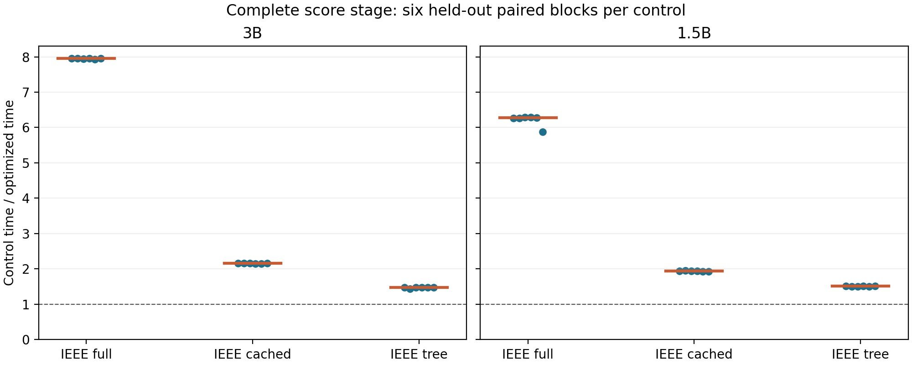

# Approximate complete-score acceleration

Measured on DGX Spark GB10 with the unchanged frozen public Qwen2.5 models and candidates.

The selected path shares the prompt and token-prefix tree, and applies the existing TF32x3
Triton arithmetic to ordinary linears. All declared JSON spellings, EOS tokens, vocabulary
denominators and eleven aggregators are retained. FP32 storage remains unchanged.

## Held-out complete scoring

Each ratio is median(control wall time / optimized wall time) across six paired ABBA/BAAB blocks.
Each window rescored the same eight pre-frozen test fixture families, including prefill,
tokenization, packing, all model work, score extraction and final aggregation. Loading,
candidate generation, first-call compilation and artifact validation are excluded.

| Model | Control | Median speed ratio | Six-block range | Empirical paired bootstrap interval |
| --- | --- | ---: | ---: | ---: |
| Qwen2.5-3B-Instruct | IEEE full | 7.9520x | 7.9333–7.9606 | 7.9395–7.9583 |
| Qwen2.5-3B-Instruct | IEEE cached | 2.1549x | 2.1514–2.1632 | 2.1516–2.1606 |
| Qwen2.5-3B-Instruct | IEEE tree | 1.4743x | 1.4305–1.4766 | 1.4506–1.4759 |
| Qwen2.5-1.5B-Instruct | IEEE full | 6.2756x | 5.8797–6.2947 | 6.0720–6.2935 |
| Qwen2.5-1.5B-Instruct | IEEE cached | 1.9360x | 1.9312–1.9479 | 1.9315–1.9431 |
| Qwen2.5-1.5B-Instruct | IEEE tree | 1.5074x | 1.4961–1.5105 | 1.5004–1.5103 |

The bootstrap is descriptive; its resamples are not additional independent trials.



## Numerical and decision fidelity

Bounds were frozen after the user allowed small errors: max token0.01 nats, token-weighted
mean0.0005 nats, max complete sequence0.1 nats, and per-aggregator plus joint agreement>=99%.
Zero-candidate pools are retained separately. Agreement concerns the FP32 reference, not gold answers.

| Model | Scored / input records | Zero pools | Token max error | Token mean error | Sequence max error | Joint agreement |
| --- | ---: | ---: | ---: | ---: | ---: | ---: |
| Qwen2.5-3B-Instruct | 119/119 | 0 | 0.001373291 | 7.775342e-06 | 0.0014944464 | 119/119 |
| Qwen2.5-1.5B-Instruct | 103/119 | 16 | 0.00013875961 | 2.070991e-06 | 0.00015908812 | 103/103 |

Raw errors, quantiles, changed IDs, margins and development/test subgroup counts are in
[independent_analysis.json](independent_analysis.json). All144 timing windows are retained
for the two-model, three-control schedule. The whole119 audit and whole-family timing
are separately validated layouts; audit batch8 applies to cached scoring, while tree
scores its packed complete family. First calls and shape setup remain in the raw archive.

## Scope and earlier attempts

This establishes faster complete scoring for the fixed workload, without a generation,
serving-throughput, universal-model, novelty or task-accuracy improvement claim. There is
no cross-call prompt cache. The same-structure FP32-tree comparator separates Tensor Core
arithmetic from prefix sharing; the cached comparator controls ordinary prompt reuse.

The initial bulk/SDPA/head grid did not yield accepted speed. The strict Tensor Core
3e-5 gates remain failures. Exact CUDA graphs passed the development numerical check
but showed approximately1x warm speed. The approximate linear-only discovery was
unconfirmed because its gain was small; native-high exceeded the fixed error budget.
The new prefix-sharing study and its stronger confirmation-control amendment are separate
prospective freezes. No earlier failed result was relabeled.

Protocols: [approximate](../../docs/APPROXIMATE_SCORING_PROTOCOL.md),
[prefix sharing](../../docs/PREFIX_APPROXIMATE_PROTOCOL.md),
[same-structure control amendment](../../docs/PREFIX_CONFIRMATION_CONTROL_AMENDMENT.md).

## Reproduction

```bash
PYTHONPATH=src .venv/bin/python scripts/analyze_approximate_scoring.py \
  --runs runs/prefix_approximate_confirmation_3b_20261013_v1 \
         runs/prefix_approximate_confirmation_1p5b_20261013_v1 \
  --output metadata/independent_reanalysis_NEW.json
```

Extract [raw_results_v1.tar.gz](raw_results_v1.tar.gz) at repository root for the snapshots.
Original reference/candidate artifacts are in the earlier public raw_results_v2 archive.
Use those frozen source snapshots for exact historical replay; do not silently substitute
a new checkpoint, runtime, dtype, normalizer, input pool or configuration. See
[MANIFEST.json](MANIFEST.json) for byte-preservation receipts and privately retained
Chrome trace exclusions. Models and gold labels are excluded.
