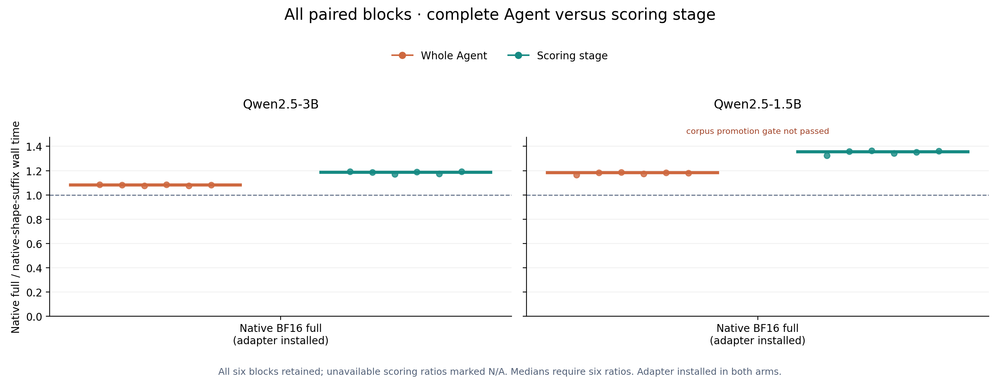
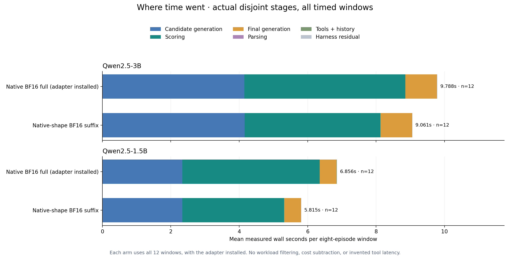

# vLLM Agent integration

Measured on DGX Spark GB10 with vLLM 0.29.0 and the pinned Qwen2.5 checkpoints.

Weights, backbone, KV cache and ordinary generation remain BF16. The optimized
scorer preserves the stock BF16 vocabulary projection and its native row shape.
Only after that full projection are suffix rows selected for native full-vocabulary
normalization, target-logprob gathering and CPU transfer. Scoring-prefix-cache reads
remain disabled. Every complete candidate spelling, first suffix predictor and EOS is retained.

The baseline uses native BF16 full scoring with the adapter installed. Unmarked
requests delegate to the original vLLM method; wrapper overhead is present in both
arms. No separate adapter-disabled engine performance arm was measured.

## Complete Agent and scoring latency

Ratios are native-full wall time / native-shape-suffix wall time. Values above one
indicate lower measured latency for the candidate. Each value is the median of six paired
ABBA/BAAB block ratios; every window executes the same eight frozen task IDs afresh.
Each model retains all 24 windows. No divergent episode or block is removed.
A zero optimized scoring-stage mean makes that block's scoring ratio unavailable.
If any block is unavailable, the scoring median and range are N/A; all Agent ratios
and every block remain in the evidence. No median is computed from a selected subset.

| Model | Control | Whole Agent median [range] | Scoring median [range] | Timed work matches | 36-task work matches | Same-workload promotion |
| --- | --- | ---: | ---: | --- | --- | --- |
| Qwen2.5-3B-Instruct | Native BF16 full (adapter installed) | 1.082x [1.075, 1.084] | 1.187x [1.170, 1.193] | yes | 36/36 | yes |
| Qwen2.5-1.5B-Instruct | Native BF16 full (adapter installed) | 1.182x [1.165, 1.187] | 1.354x [1.325, 1.366] | yes | 35/36 | no |

Timing-workload identity and the separate 36-task corpus check are distinct.
The frozen promotion gate requires both, as well as no task-success drop.
A corpus mismatch alone does not imply differing work in the timed windows.

**Qwen2.5-3B-Instruct:** All timed workload content matches across arms and repeats (A/B 192/192; A/A 48/48; B/B 48/48). The timing ratios describe the same eight frozen task IDs. Separately, 36/36 corpus episodes have identical complete workload content.

**Qwen2.5-1.5B-Instruct:** All timed workload content matches across arms and repeats (A/B 192/192; A/A 48/48; B/B 48/48). The timing ratios describe the same eight frozen task IDs. Separately, 35/36 corpus episodes have identical complete workload content.

Corpus content difference `catalog_item_06_2` (round 2: samples, candidates, scored tokens). Selected calls, actual tool observations, final text and final tokens still match.

The frozen promotion gate remains **not passed** because complete 36-task corpus content does not fully match.

Task success is reported below; no universal quality claim follows.

The stacked chart uses arithmetic mean stage times from all retained timing windows:
12 windows per arm per model. It shows seconds per
eight-episode workload, not independent request latency. Parsing, tool/history work
and the measured harness residual remain visible in the accounting even when small.
Cache reset is inside each window's harness residual. Engine initialization is separate;
first-shape work remains in the stage that incurred it, without invented subtraction.

## Actual task outcomes

Two compulsory tool rounds use real local lookup/arithmetic/calendar outputs, followed
by a model-generated final answer. Every policy retains all 36 held-out tasks, including
empty candidate pools and tool errors. Vote4 and greedy1 use different compute budgets.

| Model | Policy | Task success | Valid final JSON | Correct final value |
| --- | --- | ---: | ---: | ---: |
| Qwen2.5-3B-Instruct | Native BF16 full (adapter installed) | 36/36 | 36/36 | 36/36 |
| Qwen2.5-3B-Instruct | Native-shape BF16 suffix | 36/36 | 36/36 | 36/36 |
| Qwen2.5-3B-Instruct | Vote 4 (no scoring) | 31/36 | 36/36 | 31/36 |
| Qwen2.5-3B-Instruct | Greedy 1 (no scoring) | 35/36 | 36/36 | 35/36 |
| Qwen2.5-1.5B-Instruct | Native BF16 full (adapter installed) | 31/36 | 36/36 | 31/36 |
| Qwen2.5-1.5B-Instruct | Native-shape BF16 suffix | 31/36 | 36/36 | 31/36 |
| Qwen2.5-1.5B-Instruct | Vote 4 (no scoring) | 31/36 | 36/36 | 31/36 |
| Qwen2.5-1.5B-Instruct | Greedy 1 (no scoring) | 31/36 | 36/36 | 31/36 |

## Locked-candidate fidelity

The reference here is native full BF16 scoring with the adapter installed. These are
fixed-candidate logprob/decision checks, separate from online task success. There
are 72 round-specific pools per model; only nonempty pools enter agreement rates.

| Model | Arm | Nonempty / pools | Token max (nats) | Token mean (nats) | Sequence max (nats) | Joint agreement | Role / disposition |
| --- | --- | ---: | ---: | ---: | ---: | ---: | --- |
| Qwen2.5-3B-Instruct | Native-shape BF16 suffix | 72/72 | 0 | 0 | 0 | 72/72 | Stock-reference gate passed: yes |
| Qwen2.5-1.5B-Instruct | Native-shape BF16 suffix | 72/72 | 0 | 0 | 0 | 72/72 | Stock-reference gate passed: yes |

Frozen bounds: token max 0.05 nats, pooled mean 0.005 nats, sequence
max 0.5 nats, and at least 99% agreement for all eleven rules and their joint decision.
Earlier suffix/APC and FP32-output-head development failures remain failures.
Their measurements are not accepted native-shape confirmation results.

## Evidence and scope

This is an original deterministic local fixture suite, not an official Agent or BFCL
leaderboard, Internet-service benchmark, or population-level reliability guarantee.
The six repeated timing blocks are not hundreds of independent task trials.

Provided current and retired run intervals total **1285.417 seconds**,
a lower bound on distinct recorded process wall time. Nested stages are not added again.
It is not pure GPU-busy time or a complete project budget. Independent analysis and
this rendering step have separate costs. Earlier failed attempts remain in the analysis.

[Machine summary](summary.json) · [Independent analysis](independent_analysis.json) ·
[Render receipt](RENDER_RECEIPT.json) · [Native-shape protocol](../../docs/VLLM_AGENT_SHAPE_PROTOCOL.md)
